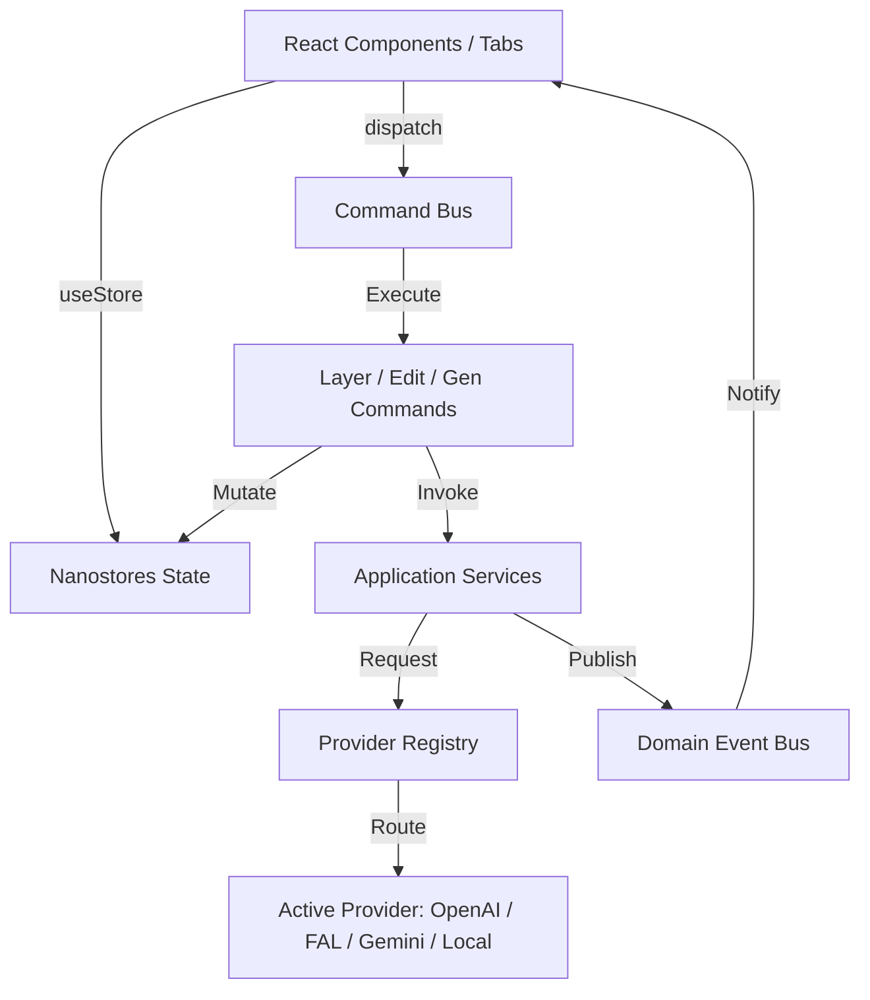
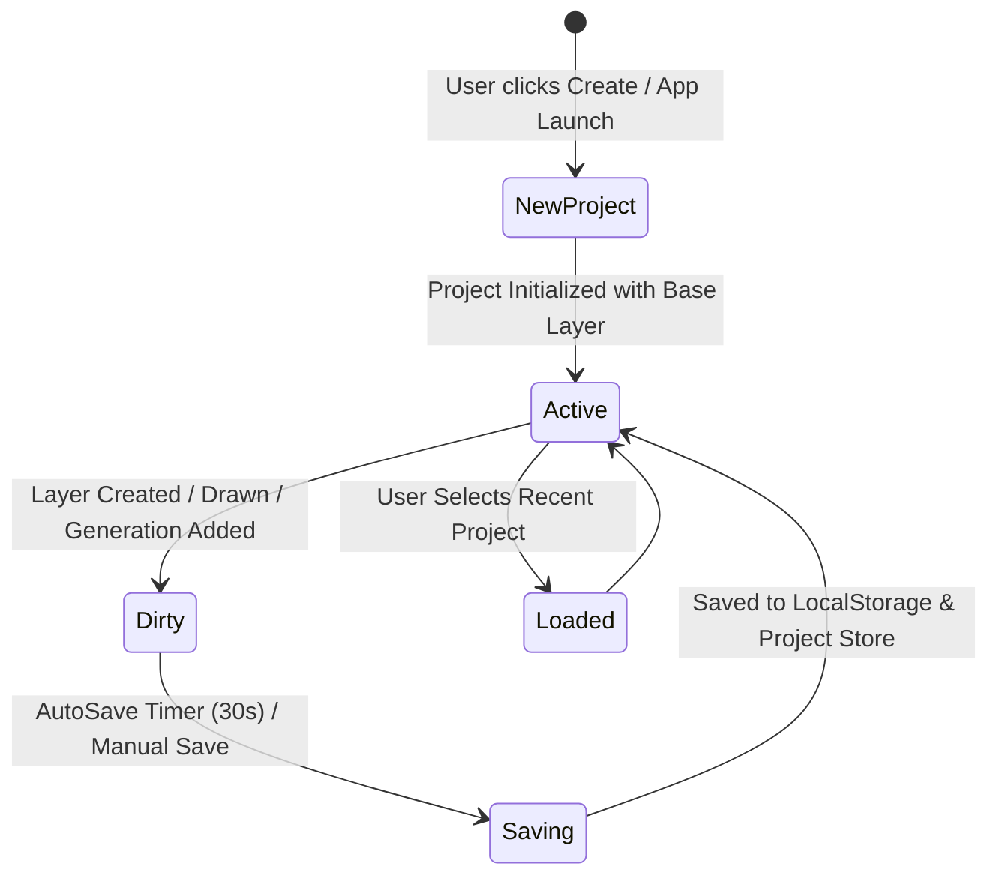

# TchueKAM Image Studio v2 — System Architecture Specification

## 1. Executive Summary & Overview

TchueKAM Image Studio v2 is a provider-independent, event-driven, modular creative studio suite built inside TchueKAM Desktop. It decouples UI components, business logic, canvas engine subsystems, provider adapters, command dispatching, and nanostores state management.

---

## 2. Directory Architecture

```
/src/app/image-studio
├── core/
│   ├── models/            # Entity factories (Project, Layer, Metadata, Serialization)
│   ├── types/             # Domain TS interfaces (CanvasLayerState, GenerationParams, etc.)
│   ├── constants/         # Constants, aspect ratios, style presets, quality mappings
│   └── errors/            # Structured error hierarchy (StudioError, ProviderError, etc.)
├── application/
│   ├── events/            # Decoupled EventBus & domain events
│   ├── commands/          # Command pattern & bus (CreateLayer, DeleteLayer, etc.)
│   ├── services/          # Services (ProjectService, GenerationService, VisionService, etc.)
│   ├── project/           # Project lifecycle & autosave engine
│   └── history/           # Undo/Redo command manager
├── stores/                # Nanostores state management
│   ├── project.store.ts   # $activeProject, $recentProjects, $isSaving
│   ├── canvas.store.ts    # $canvasZoom, $canvasPan, $activeTool, $brushConfig, $showGrid
│   ├── layer.store.ts     # $layers, $activeLayerId
│   ├── selection.store.ts # $selectionBounds
│   ├── history.store.ts   # $canUndo, $canRedo
│   ├── generation.store.ts# $promptText, $generatedImages, $isGenerating
│   ├── provider.store.ts  # $activeProviderId, $availableProviders, $activeCapabilities
│   ├── asset.store.ts     # $libraryItems, $libraryFilter, $librarySearch
│   └── ui.store.ts        # $activeTab, $toastMessage
├── providers/             # Provider Abstraction Layer
│   ├── base/              # IStudioProvider interface & Capability flags
│   ├── openai/            # OpenAI DALL-E & GPT-4o Vision provider
│   ├── fal/               # FAL AI FLUX 2 Klein provider
│   ├── gemini/            # Google Gemini provider
│   ├── local/             # Offline SVG canvas synthesizer provider
│   └── registry.ts        # Provider Registry & automatic capability routing
├── canvas/                # HTML5 Canvas Engine Subsystems
│   ├── renderer/          # Composite layer renderer
│   ├── tools/             # Brush & mask stroke engine
│   └── history/           # Canvas pixel snapshot stack
├── templates/             # Graphics templates builder engine
├── mockups/               # Realistic product mockups engine
├── export/                # PNG, JPEG, WebP & OCR exporter
├── hooks/                 # Custom React hooks (useProject, useCanvas, useLayers, etc.)
├── components/            # Decoupled UI components (< 400 LOC per file)
└── index.tsx              # Main entry point re-exporting ImageStudioView
```

---

## 3. Dependency Hierarchy & Layering Rules

All module dependencies strictly follow unidirectional top-down flow:

$$\text{UI Components} \longrightarrow \text{Hooks / Stores} \longrightarrow \text{Application Services / Commands} \longrightarrow \text{Core Domain / Provider Registry}$$

- **UI Components** never call Provider APIs directly.
- **Commands** validate inputs and mutate Stores.
- **Providers** implement standard `IStudioProvider` contracts.

---

## 4. Component Interaction Diagram



---

## 5. Project Lifecycle



---

## 6. Provider Capabilities Matrix

| Provider ID | Name | Text-to-Image | Inpainting | Vision | OCR | Status |
| :--- | :--- | :---: | :---: | :---: | :---: | :---: |
| `openai` | OpenAI DALL-E & GPT-4o | ✅ | ✅ | ✅ | ✅ | Active |
| `fal` | FAL AI FLUX 2 Klein 9B | ✅ | ✅ | ❌ | ❌ | Active |
| `gemini` | Google Gemini | ✅ | ❌ | ✅ | ✅ | Active |
| `local` | Local Canvas Synthesizer | ✅ | ❌ | ❌ | ❌ | Fallback |
