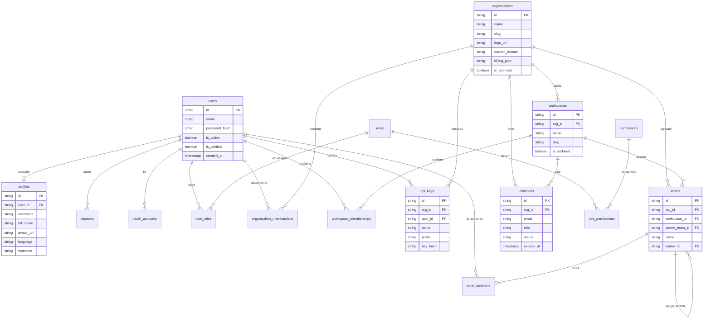

# TchueKAM Backend - Diagramme Entité-Association (ERD Diagram)

Diagramme Mermaid complet modélisant les 16 tables relationnelles du système d'Information TchueKAM (Authentification, RBAC, Organisations, Workspaces, Équipes, Invitations et Clés API).

