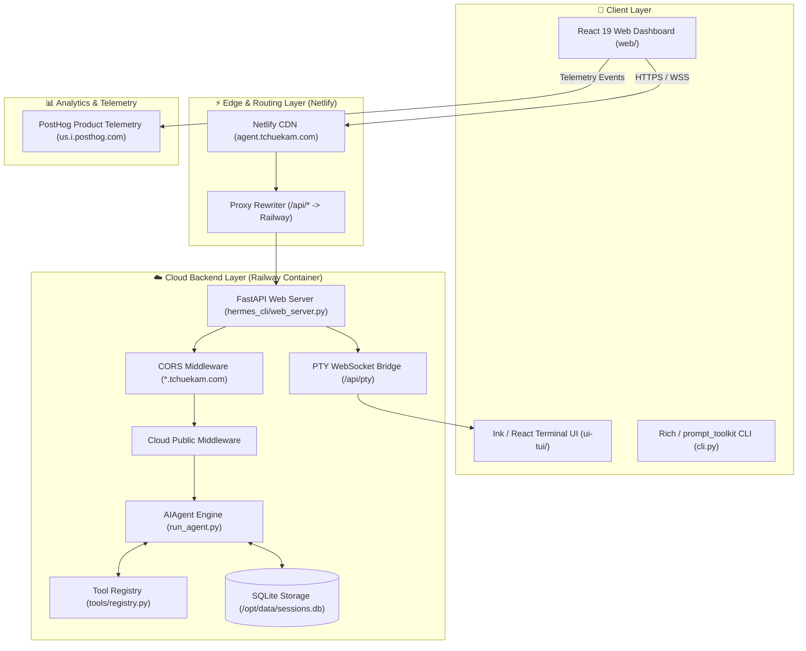
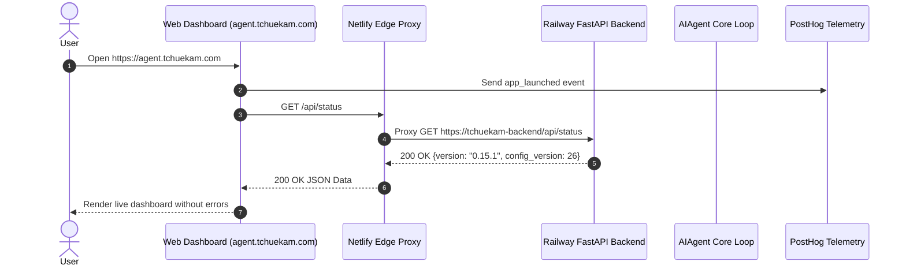

# 🏗️ System Architecture

**Tchuekam Agent** is a full-stack, cross-platform AI agent framework. It provides interactive terminal interfaces (CLI and TUI), a rich web dashboard (React 19 SPA), a FastAPI backend API, 24/7 cloud containerization (Railway + Netlify Edge), and PostHog product analytics telemetry.

---

## 📐 Top-Level Component Architecture



---

## 🔍 Core Subsystem Breakdown

### 1. Web Dashboard SPA (`web/`)
- **Framework**: React 19, TypeScript, Vite, Tailwind CSS / Vanilla CSS design tokens.
- **State Management**: Nanostores & React hooks.
- **API Client**: `web/src/lib/api.ts` handles REST endpoints (`/api/status`, `/api/models`, `/api/sessions`).
- **Telemetry**: `web/src/lib/posthog.ts` provides privacy-conscious PostHog product telemetry (`POSTHOG_API_KEY = phx_JurRLsvu...`).

### 2. Backend Web Server (`hermes_cli/web_server.py`)
- **Engine**: FastAPI async server running on Uvicorn.
- **Proxy Middleware**:
  - `CORSMiddleware`: Configured to permit requests from `*.tchuekam.com`, `*.netlify.app`, `*.up.railway.app`, `localhost`, and `127.0.0.1`.
  - `auth_middleware`: Grants public read access to `/api/status`, `/api/config/defaults`, `/api/model/info`, and `/api/dashboard/themes` when deployed in cloud environments (`is_cloud`).

### 3. Edge Reverse Proxy (`netlify.toml`)
- Netlify routes static web assets for `agent.tchuekam.com` while proxying `/api/*` requests to the Railway cloud container:
  ```toml
  [[redirects]]
    from = "/api/*"
    to = "https://tchuekam-backend-production.up.railway.app/api/:splat"
    status = 200
    force = true
  ```

### 4. Cloud Containerization (Railway)
- Running 24/7 in an isolated Linux container.
- **Data Persistence**: Mounts `/opt/data` for `config.yaml`, `.env`, `SOUL.md`, `sessions/`, and SQLite databases.
- **Start Command**: `python -m hermes_cli.main dashboard --host 0.0.0.0 --port $PORT --insecure`.

---

## 🔄 Data & Execution Flow


