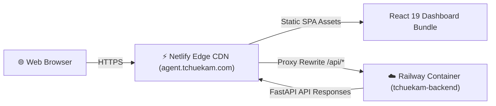

# ☁️ Cloud Deployment Guide

This document explains how **Tchuekam Agent** is deployed in production to provide 24/7 cloud execution at **[https://agent.tchuekam.com](https://agent.tchuekam.com)**.

---

## 🏗️ Cloud Infrastructure Overview



---

## 1. Railway Backend Container Setup

### Deployment Commands

```bash
# Login to Railway
npx @railway/cli login

# Link project
npx @railway/cli link --project f3cdfe86-2594-4de2-b212-de85873595e2

# Deploy service
npx @railway/cli up --service 17385b66-4231-4e96-bcf7-b2a136ce6ad9
```

### Environment Variables Matrix

| Variable Name | Description | Example Value |
|---|---|---|
| `RAILWAY_ENVIRONMENT` | Active environment flag | `production` |
| `PORT` | Container HTTP bind port | `9119` (or assigned by Railway) |
| `POSTHOG_API_KEY` | PostHog product telemetry key | `phx_JurRLsvuQkiD4aw...` |
| `HERMES_HOME` | Application state root | `/opt/data` |

---

## 2. Netlify Frontend Proxy Setup

In `netlify.toml`, configure the proxy rule rewrite:

```toml
[build]
  command = "npm run build"
  publish = "hermes_cli/web_dist"

[[redirects]]
  from = "/api/*"
  to = "https://tchuekam-backend-production.up.railway.app/api/:splat"
  status = 200
  force = true

[[redirects]]
  from = "/*"
  to = "/index.html"
  status = 200
```

### Deploy Command

```bash
npx netlify-cli deploy --dir hermes_cli/web_dist --prod
```

---

## 3. CORS & Security Best Practices

In `hermes_cli/web_server.py`, ensure cross-origin access is permitted for your domains:

```python
app.add_middleware(
    CORSMiddleware,
    allow_origin_regex=r"^https?://(.*\.tchuekam\.com|tchuekam\.com|.*\.netlify\.app|.*\.up\.railway\.app|localhost|127\.0\.0\.1)(:\d+)?$",
    allow_methods=["*"],
    allow_headers=["*"],
)
```

This guarantees clean, secure communication between Netlify Edge and the Railway backend.
